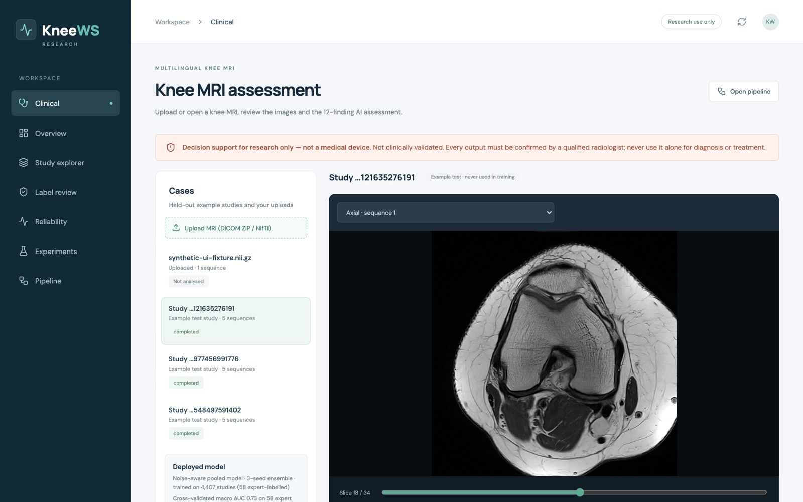
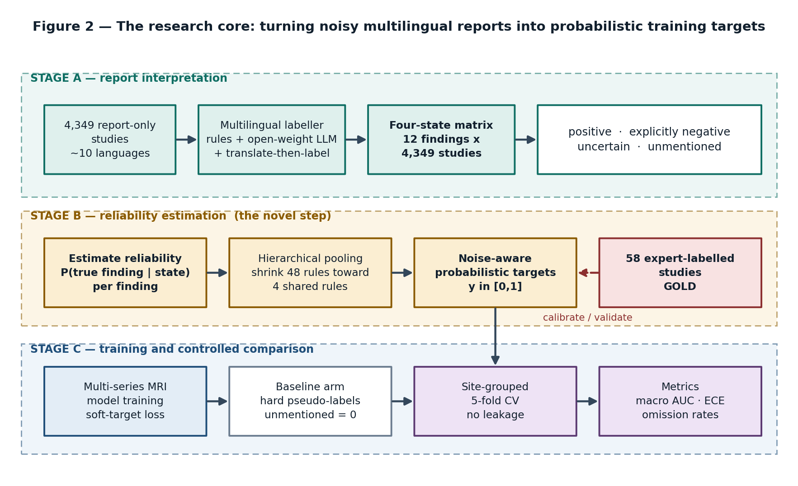
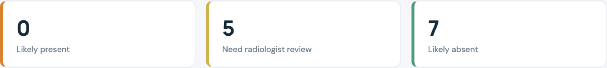
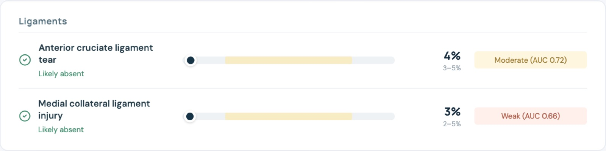
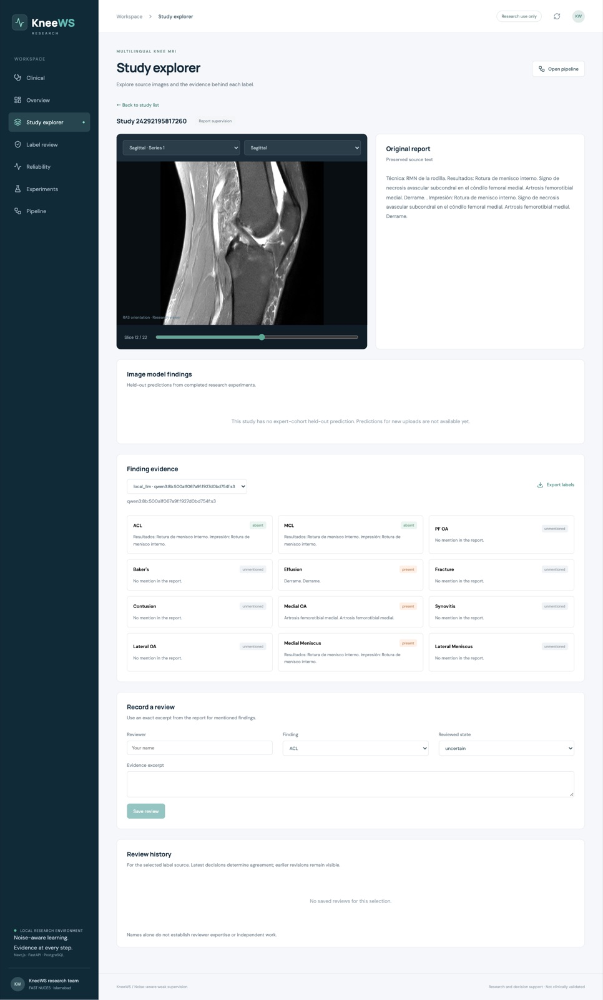
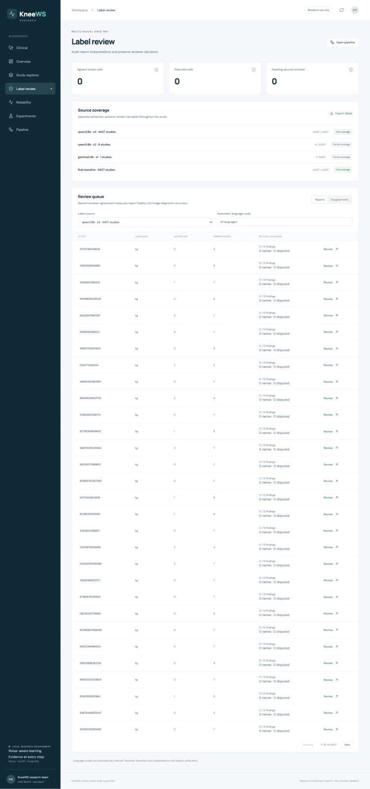
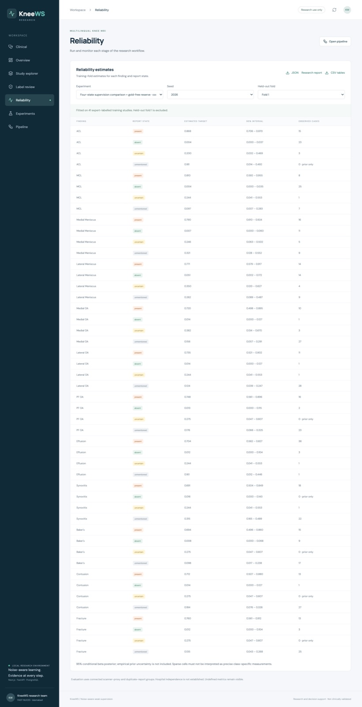
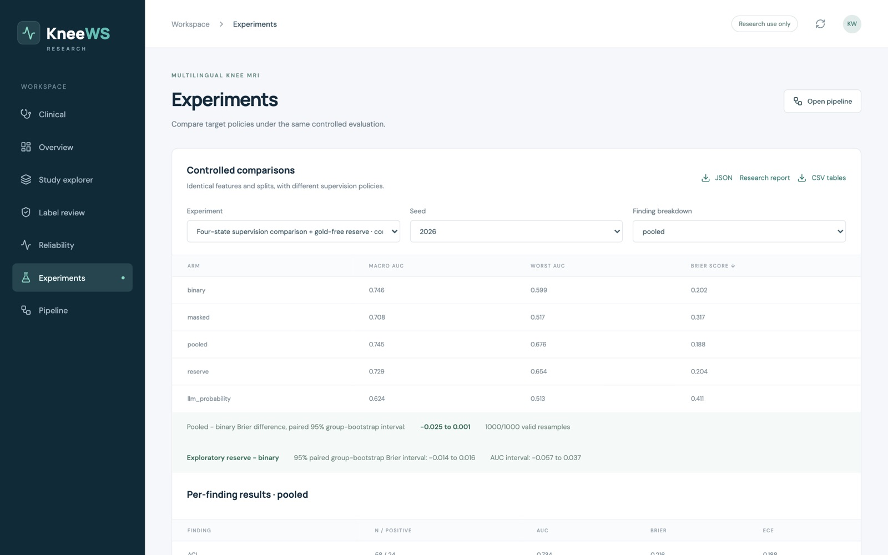

# KneeWS: Knee MRI Diagnosis from Noisy, Multilingual Radiology Reports

**Train a medical-imaging model when you only have a few expert labels and thousands of messy reports.**

KneeWS is a full-stack research system for knee MRI. It reads multilingual radiology reports, converts them into
reliability-weighted training labels, trains a multi-label MRI model for **12 knee findings**, and serves it in a clinical-style
viewer with calibrated probabilities, abstention and a printable report.



> Research software, **not a medical device**. Every output must be confirmed by a qualified radiologist.

---

## The problem

Hospitals have thousands of MRI studies with a free-text report, but only a handful are labelled by experts.
Reports are written in many languages, often hedge ("possible tear"), and silently omit findings.
Treating them as ground truth teaches a model the reporting noise.

## The approach



1. **Ingest:** real DICOM and NIfTI studies, protocol profiling, laterality and geometry checks (4,410 studies, 24,386 series).
2. **Label:** a local open-weight LLM (Qwen3-8B via Ollama) plus rules turns each report into a
   **four-state** label per finding: *positive / explicitly negative / uncertain / unmentioned*, with a quoted source span as evidence.
   No report text or image leaves the machine.
3. **Estimate reliability:** a hierarchical Bayesian estimator learns, for every finding and every state,
   how often the report is actually right, using the 58 expert-labelled studies. The output is a soft target in [0, 1].
4. **Train:** a frozen **DINOv2** encoder builds 2.5D multi-series MRI features, and a multi-label head is trained
   on the soft targets. Four matched training arms (binary, uncertainty masking, pooled reliability, LLM probability) use identical folds and seeds.
5. **Evaluate honestly:** 5-fold cross-validation grouped by scanner and duplicate reports, so no leakage between folds.
   Macro and worst-finding AUC, Brier score, ECE, and breakdowns by language and scanner group.

## Results (58 expert-labelled studies, cross-fitted, 3-seed ensemble)

| Training arm | Macro AUC | Brier ↓ | ECE ↓ |
|---|:---:|:---:|:---:|
| Binary pseudo-labels (baseline) | 0.763 | 0.189 | 0.154 |
| **Noise-aware pooled reliability (ours)** | **0.746** | **0.186** | **0.112** |

Discrimination is statistically equivalent; the noise-aware model is **clearly better calibrated**:
its probabilities mean what they say, which matters when a clinician reads a "12% chance".
Per-finding AUCs range from 0.68 (medial meniscus) to 0.82 (effusion).

## Product

| Clinical assessment | Findings with confidence and reliability |
|---|---|
|  |  |
| **Report evidence for every label** | **Expert label review** |
|  |  |
| **Reliability estimates** | **Experiments and metrics** |
|  |  |

- MRI viewer with slice navigation for DICOM and NIfTI, plus upload with protocol confirmation
- 12 findings grouped by anatomy (ligaments, menisci, cartilage/OA, effusion, synovitis, Baker's cyst, contusion, fracture)
- Calibrated probability, seed range and an **abstention band** that sends uncertain findings to a radiologist
- Disagreement explorer and label-review workflow with reviewer history
- Reproducible jobs: configs, seeds and hashes stored in PostgreSQL

## Tech stack

**ML:** PyTorch (Apple MPS / CUDA), DINOv2, scikit-learn, hierarchical Bayesian reliability model, local LLM via Ollama
**Backend:** FastAPI, PostgreSQL, SQLAlchemy and Alembic, durable job worker
**Frontend:** Next.js and TypeScript
**Quality:** 56 backend tests (pytest), browser smoke tests

## Run locally

Requires Node 22+, Python 3.12, PostgreSQL and Ollama.

```sh
python3.12 -m venv .venv312
.venv312/bin/pip install -r backend/requirements.lock.txt
cd web && npm ci && cd ..
cp .env.example .env
npm run dev            # UI http://127.0.0.1:3200 · API docs http://127.0.0.1:8200/docs
```

Data: [RSNA Knee Abnormality Detection](https://www.kaggle.com/competitions/rsna-knee-abnormality-detection)
(`KAGGLE_API_TOKEN=... ./download-rsna.sh`). The dataset and trained weights are not included in this repository.

## Repository layout

```
backend/app/            FastAPI API, ingestion, jobs, uploads
backend/app/research/   labelling, reliability, features, training, metrics, inference
backend/tests/          pytest suite
web/                    Next.js clinical and research interface
scripts/                dataset extraction, LLM labelling, re-runs, UI smoke test
```
